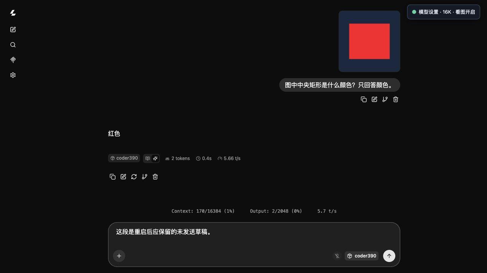

# Coder390 Mac

把已有的 Coder390 GGUF 接到优化后的 llama.cpp，在 Apple Silicon Mac 上启动本地聊天界面和 OpenAI 兼容 API。

**用户自备模型。本仓库不会下载、转换或上传模型权重。** 首次运行只准备固定版本的引擎源码、CMake 和官方聊天界面，并在用户自己的 Mac 上编译。

> 预览版。优化方案与 Q3/Q8 在 M2 Ultra 上已有实测；M1 Max 32GB 提供保守配置，但尚未经过该硬件的实机验收。请不要把 M2 Ultra 的速度当作 M1 Max 的速度。

## 第一次使用：按这四步操作

**第一次下载用 `git clone`；已经下载过项目，更新才用 `git pull`。** 下载项目本身不会启动模型。以下以 M1 Max 32GB 和标准 Q3 模型为例。

### 1. 准备 Mac 开发工具

需要原生 Apple Silicon macOS、Python 3.9 或更新版本、至少 32GB 统一内存，以及约 4GiB 的构建空间（不含模型）。打开 macOS 的“终端”，安装 Apple Command Line Tools：

```sh
xcode-select --install
```

完成系统弹出的安装窗口后再继续；如果提示已安装，无需重复安装。检查 Python：

```sh
python3 --version
```

应显示 Python 3.9 或更新版本。不要使用 Rosetta 下的 Intel Python。无需另装 Homebrew、Node.js 或 pip 依赖。

### 2. 准备自己的模型文件

从[作者 ModelScope 仓库](https://modelscope.cn/models/Merkyor/Qwen3.8-27B-Coder390-EfficientThink-Opus5.5-GPT6Astra-Grok4.7-DSV4Pro-K3-SFT-RLOO-GGUF-NInfer)自行下载，或直接使用已有文件。**32GB 机器按下面的完整文件名选择标准 Q3；不要把 Q8 主模型当成 Q8 视觉投影。**

| 文件 | 用途 | 大小 |
|---|---|---:|
| `Qwen3.8-27B-Coder390-EfficientThink-Q3LynnStyle-MTP.gguf` | 主模型，必需 | 约 16.1GiB |
| `mmproj-Qwen3.8-27B-Q8_0.gguf` | 看图所需的视觉投影 | 约 600MiB |

想开启看图，把这两个文件放在**同一个目录**，保留投影文件名，启动时就会自动识别。主模型是 Q3、投影文件名含 Q8 是正常搭配。只有主模型也能启动，但只能文字聊天。

文件可以放在你自己的模型目录，不必放进代码仓库。这个脚本不会替你下载模型。投影在不同目录时，见下方[开启看图](#开启看图包括32gb配置)。

### 3. 下载项目

在终端依次运行（以下把项目放在你的用户目录）：

```sh
cd ~
git clone https://github.com/chenwenhao0326-arch/coder390-mac.git
cd coder390-mac
```

### 4. 启动并打开聊天页面

**把下面引号内的内容替换成你实际的主模型文件完整路径**，包含最后的 `.gguf` 文件名。可在 Finder 中选中文件，按 **Option + Command + C** 复制路径，再粘贴到引号内；保留两侧引号，避免路径中的空格影响命令。

```sh
python3 coder390.py run --model "/你的模型目录/Qwen3.8-27B-Coder390-EfficientThink-Q3LynnStyle-MTP.gguf"
```

第一次会下载约 87MB 构建组件、校验并编译引擎，然后加载模型；这一步需要等待，不是再次下载模型权重。脚本会自动打开聊天页面，**等右上角“模型设置”面板显示就绪后再发送消息**。浏览器没有自动打开时，复制终端打印的完整链接进入，默认地址是 `http://127.0.0.1:8793/`。

32GB 默认使用 8K 上下文。看图开启后，可在聊天输入区添加图片并提问。**终端需要保持打开；在该终端按 Ctrl+C 停止模型。只关闭浏览器标签页不会停止模型。**

## 页面里可以调什么

页面右上角有 **“模型设置”**：可选择实际上下文容量、开启看图并填写视觉投影路径。点击 **“应用并重启”** 后，页面显示进度，完成后刷新；不需要回到终端修改参数。模型正在生成时拒绝切换，已有聊天记录和未发送文字会保留。未发送附件请先处理。

32GB 可以选择 **4K / 8K / 16K**；建议先使用默认 8K。上下文调整会重启模型，不是即时扩大当前缓存。设置自动保存在本机，下次启动同一模型会恢复。



截图用于展示图片输入和上下文设置，里面的短回答 tok/s 不是性能基准。

## 下次启动、停止和更新

**下次启动不用重新下载项目。** 新开终端，进入原目录，使用自己的模型路径执行同一条命令：

```sh
cd ~/coder390-mac
python3 coder390.py run --model "/你的模型目录/Qwen3.8-27B-Coder390-EfficientThink-Q3LynnStyle-MTP.gguf"
```

后续启动复用已编译的引擎。想停止时，在运行它的终端按 **Ctrl+C**。

**更新项目**：先按 Ctrl+C 停止旧服务，再运行：

```sh
cd ~/coder390-mac
git pull --ff-only
python3 coder390.py run --model "/你的模型目录/Qwen3.8-27B-Coder390-EfficientThink-Q3LynnStyle-MTP.gguf"
```

如果最初把仓库放在其他位置，以上 `cd` 改为那个目录。更新后使用启动脚本输出的新链接进入；升级只处理 llama-ui 静态资源缓存，不删除聊天数据库。若 Git 提示本地修改冲突，先保留自己的改动再处理，不要强制覆盖。

模型文件始终留在原位置，不复制进项目。不需要商业 API 或登录账号。本项目只提供模型服务和聊天页面，**不包含 DSH 或开发 Agent**。

## 支持的模型

面向作者 Merkyor / nerkyor 的 **Qwen3.8-27B Coder390 EfficientThink** 单文件 GGUF，要求内置一个 MTP 层，词表、特殊 token、聊天模板、架构和张量形状与已验证版本一致。启动前会检查这些项目；它不是所有 Qwen/GGUF 模型的通用启动器。

32GB 建议使用已经验证能够被本引擎加载的标准 Q3 包：

```text
Qwen3.8-27B-Coder390-EfficientThink-Q3LynnStyle-MTP.gguf
```

该文件约 16.1GiB，SHA256：

```text
9985b3d41fc7dc0bb5d493f7523d4515504912a3a7fc830f66e0fd2f90f9fd95
```

这里的 Q3 是混合量化，内置草稿头为 Q4；`MTP4` 是草稿长度 4，不是量化位数。32GB 配置不接受约 27GiB 的 Q8 文件。

模型由用户自行从[作者 ModelScope 仓库](https://modelscope.cn/models/Merkyor/Qwen3.8-27B-Coder390-EfficientThink-Opus5.5-GPT6Astra-Grok4.7-DSV4Pro-K3-SFT-RLOO-GGUF-NInfer)或对应 Hugging Face 仓库取得，遵循模型自己的许可证。脚本检查结构，不替代用户的完整文件 SHA256 校验。

## 默认配置

| 配置 | 自动选择 | 上下文 | 并发 | batch / ubatch | 默认输出预算 |
|---|---|---:|---:|---:|---:|
| `compact32` | 32～36GB | 8192 | 1 | 512 / 128 | 2048 |
| `balanced` | 大于 36GB | 32768 | 1 | 2048 / 512 | 4096 |

两者均使用 Metal 全层卸载、Flash Attention、F16 KV、概率 MTP4、p_min 0.2、131072 项草稿词表、紧凑 Top-K 和已采用的小算子线程分配优化。原模型的完整词表和权重不变。

32GB 从 8K 上下文开始，页面可选4K、8K、16K；更大内存配置提供更多档位，应用前检查保守内存预算。窗口改变后服务端缓存会重新建立，较小窗口可能需要新建对话。M2 Ultra测试不能替代M1 Max32GB实机验收。

输出预算较短，复杂思考可能被截断，需要结合任务调整；API调用方或界面中已有的个人设置可以覆盖默认输出预算。页面设置会保存，下次启动同一模型/配置时恢复；显式命令行参数优先。

```sh
python3 coder390.py run --model "/路径/模型.gguf" --profile compact32 --context 8192
```

## 开启看图（包括32GB配置）

模型主文件和视觉投影是两个文件。用户自行准备匹配的 `mmproj-Qwen3.8-27B-Q8_0.gguf`（约600MiB）。放在主模型同目录时自动识别并开启；不同目录可指定：

```sh
python3 coder390.py run --model "/路径/模型.gguf" --mmproj "/路径/mmproj-Qwen3.8-27B-Q8_0.gguf"
```

也可以先启动，在页面 **模型设置 → 视觉投影文件路径 → 启用看图 → 应用并重启**。路径指这台运行模型的Mac上的文件，不是上传权重到网页。首次完整校验投影SHA256；文件未改变时复用校验回执。

没有投影文件时保持文字模式，页面会提示填写，不会下载权重或假装看图已开启。32GB配置限制图片处理规模至1024个图像token，并监控模型进程RSS；超过预算会停止所属模型并显示原因，不调整系统内存限制。图片越大、越多，实际资源需求越高。

本版已验收图片输入；不宣称已验证视频、音频或所有多模态场景。需要关闭看图可在面板取消勾选，或启动时加 `--no-vision`。

若新配置加载失败，会尝试恢复此前工作的配置；无效路径、校验失败或生成中的切换会在停止旧模型前被拒绝。

## 网络、离线和诊断

### 常见问题先看这里

| 现象 | 怎么处理 |
|---|---|
| `can't open file ... coder390.py` | 先 `cd` 到下载的 `coder390-mac` 目录，再执行启动命令。 |
| 找不到模型文件 / `No such file or directory` | 检查 `--model` 后是否仍是示例路径；必须填写实际文件的完整路径，保留引号。 |
| 提示模型契约不匹配、没有 MTP 层 | 对照上面的完整文件名；不是任意 Qwen GGUF 都能套用本项目。不要关闭校验硬跑。 |
| 页面能聊天，但不能看图 | 确认匹配的 `mmproj` 已下载；在“模型设置”填写投影路径、勾选“启用看图”，应用并重启。 |
| 页面没有“模型设置”按钮 | 确认已更新并重新启动脚本，用终端打印的新链接打开页面。 |
| 提示地址/端口已占用 | 先停止自己之前启动的实例，或在启动命令末尾加 `--port 8795`；打开终端打印的新地址。不要误停其他服务。 |
| 提示内存预算不足 | 启动命令末尾加 `--context 4096`；必要时加 `--no-vision` 先使用文字模式。关闭不用的占内存应用。 |
| 编译阶段一段时间没有新输出 | 在另一个终端进入项目目录，运行 `tail -n 40 .coder390/build.log` 查看构建进展；不要重复启动。 |
| 编译失败 / 模型加载失败 | 分别查看 `.coder390/build.log` / `.coder390/server.log`；不同 macOS/SDK 尚未逐一验收，保留具体错误用于定位。 |

下面的命令只检查硬件、引擎准备状态和模型结构，**不会加载模型或生成回答**。首次编译前 `engine_ready: false` 是正常状态：

```sh
python3 coder390.py doctor --model "/你的模型目录/Qwen3.8-27B-Coder390-EfficientThink-Q3LynnStyle-MTP.gguf"
```

### 首次下载与离线准备

首次准备只下载约 87MB 的公开构建组件，来源和 SHA256 固定在 `engine.lock.json`。使用物理网卡直连，显式禁用代理；逐跳检查连接，不自动更换代理或修改系统路由。默认自动查找物理网卡，可手动指定：

```sh
python3 coder390.py setup --interface en0
python3 coder390.py doctor --model "/路径/模型.gguf"
```

本机网络如果要求 VPN/代理，自动直连可能失败。可在能访问官方地址的环境自行取得 `engine.lock.json` 中的三个文件，保持文件名不变放到缓存目录，使用：

```sh
python3 coder390.py setup --offline --cache-dir "/路径/构建组件缓存"
python3 coder390.py run --offline --model "/路径/模型.gguf"
```

准备完成后启动和推理不访问模型下载服务。日志与临时文件只在 `.coder390/`，已排除 Git：

- `build.log`：编译诊断。
- `server.log`：模型加载、MTP 和请求耗时。
- `last-run.json`：本次准确启动参数。
- `user-settings.json`：保存的上下文和看图设置，仅在本地。

默认仅监听本机。端口被占用时会停止启动，不会结束别的服务；也可用 `--port 8795`。`--no-open` 不自动打开浏览器。

API 地址为 `http://127.0.0.1:8793/v1`，模型别名 `coder390`。本项目不包含 DSH、Agent 会话或模型下载器。

页面与API使用固定本机端口；模型运行在管理器持有的私有本机端口，重启期间新推理请求返回503。设置接口要求同源和会话令牌，防止外部网页擅自重启模型；服务端API客户端无需额外配置管理令牌。

## 复现与验证

引擎固定在 llama.cpp `620d2225cc436ab0b001e3200e590e3b286ef9ab`，依次应用 `patches/` 中三份补丁。补丁后源码对照已采用版本的摘要；编译发生在用户机器上，不分发本机 M2 编译出的二进制给 M1 使用。

```sh
python3 -m unittest discover -s tests -v
```

具体已测项目和未测边界见 [v0.2验证记录](docs/VALIDATION-v0.2.md)；[v0.1记录](docs/VALIDATION.md)保留。性能数据见 [实测摘要](docs/PERFORMANCE.md)。Node.js仅用于可选的服务工作线程回归检查：`node tests/sw-lifecycle.mjs`，不是运行依赖。

## 许可与来源

启动脚本和本项目改动使用 MIT；llama.cpp 原有版权和许可保留在 `licenses/llama.cpp-MIT.txt`。引擎、CMake、聊天界面和用户模型分别保留各自许可证，见 [来源说明](NOTICE.md)。本仓库不包含账号凭据、模型文件或开发会话日志。
