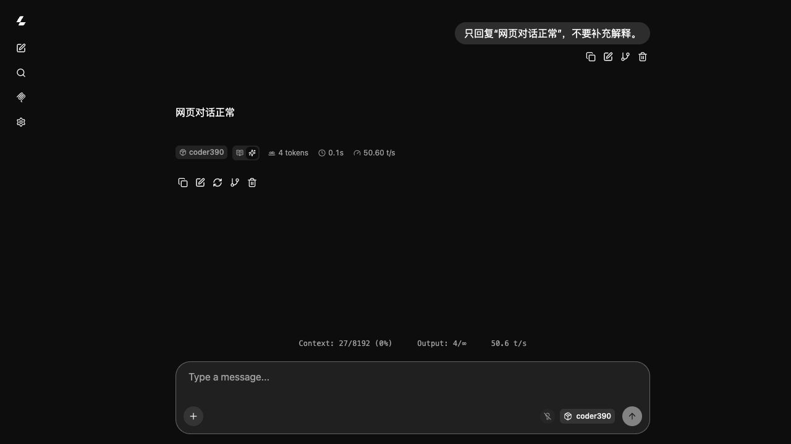

# Release validation — 2026-10-28

Status: clean-checkout build and bounded runtime/browser checks passed on **Apple M2 Ultra / 192GB / macOS26.4.1**, using the `compact32` preset.

## Verified

- Cloned the candidate Git repository into a separate directory whose path contains spaces. No original project engine directory or absolute user path is part of the package.
- Reused SHA256-pinned source/CMake archives in an explicit offline artifact cache; fetched the pinned official UI archive directly through GitHub's release-asset API and verified its SHA256. The source archive and CMake wheel had already been fetched through the same direct transport. A brand-new online end-to-end download of all three artifacts was not repeated.
- Applied the three patches to the original pinned source archive. All21 changed source files match the adopted engine's source hashes.
- Compiled a fresh engine with embedded Metal shaders. The first build exposed an unintended Homebrew OpenSSL dependency; the build policy was fixed and the affected build repeated. Final `otool -L` contains only macOS system libraries/frameworks. No Homebrew runtime library is required.
- Eleven focused checks passed: the original8 portability/model/archive/route/port checks,2 native-cache ownership checks and1 UI/API output-budget consistency check. Passed unaffected checks were not repeatedly run. Network error cases are mocked; they are not model inference tests.
- Loaded the existing standard `Q3LynnStyle-MTP.gguf` by an external local path, using `compact32`:8192 context, batch512/128, F16 KV, MTP4, one request at a time, no vision projector.
- `/v1/models` exposed `coder390`; one real `/v1/chat/completions` request returned the requested Chinese response.
- In a real browser, the official UI connected, sent a separate short message and displayed the expected Chinese response,8192-token context and generation statistics. The initial navigation occurred before readiness and was retried after the service was ready.
- Peak model-process RSS observed during loading and the two short interactions: **19.46GiB**. This is a smoke-test measurement, not peak memory at a full8K prompt or a multi-turn workload.
- Logs confirm native MTP,131072-of248320 draft vocabulary and compact Top-K activation. Default daily Q8 configuration was not changed.
- Terminating the release launcher shut down its owned model process; the test port was released. No daily model service was left running.

## Limits

- **M1 Max32GB has not been physically tested.** Its24/32-core GPU variants, system memory pressure, macOS/SDK combinations and sustained performance require target-device acceptance. A successful M2 test cannot certify that hardware.
- The package builds natively on the user's Mac; it does not ship an M2-native binary to M1. A cache recorded as built on another chip is rejected.
- The supplied model contract is strict. A different tokenizer/template/architecture must be reviewed before reusing the fixed draft vocabulary. Merely having “27B” or “Q3” in a filename is insufficient.
- No new full inference benchmark, broad quality evaluation, image test or DSH end-to-end run was performed for this packaging change.
- The final UI output-budget default was aligned with the API default and checked separately without repeating the passed inference requests. Existing browser preferences can override it.

The screenshot's4-token instantaneous speed only demonstrates the UI statistics display; it is not a throughput benchmark.
